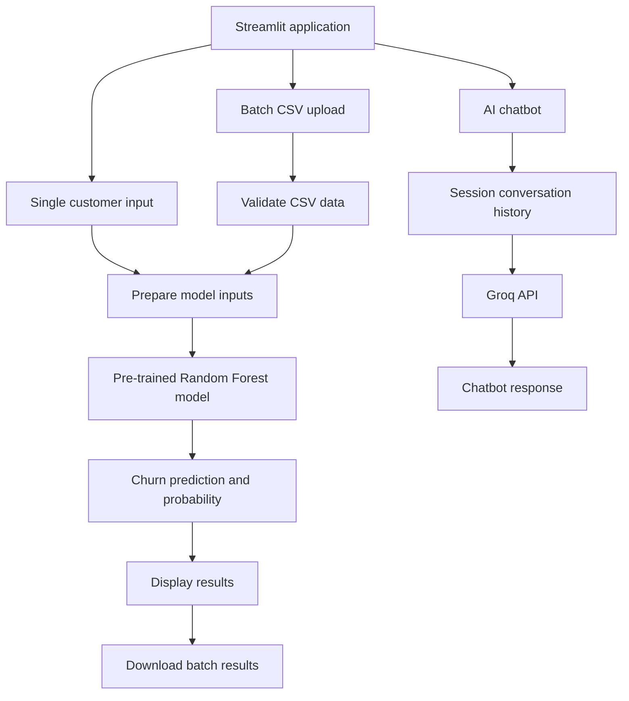

# Bank Customer Churn Prediction & AI Chatbot

An interactive machine learning portfolio project for predicting bank customer churn and exploring churn-related questions through an AI chatbot. The application combines a pre-trained Random Forest model, Python data processing, and a Streamlit web interface.

## Project overview

Customer churn prediction is a binary classification task: given customer attributes, the model predicts whether a customer is likely to leave or stay. This project demonstrates how a trained machine learning model can be integrated into an interactive application for individual and batch inference.

## Features

- **Individual prediction:** Enter six customer attributes and obtain a predicted churn status and, when supported by the model, an estimated exit probability.
- **Batch prediction:** Upload a CSV file to predict churn for multiple customers, view a summary of results, and download the predictions as a CSV.
- **Input validation:** Checks for missing columns, empty files, nonnumeric values, and non-finite values in batch inputs.
- **AI chatbot:** Uses the Groq API to answer questions about machine learning and customer churn, retaining conversation history within the current Streamlit session.
- **Application state and error handling:** Preserves batch results across Streamlit reruns and handles common model-loading and chatbot API errors.

The application interface and code comments are in English.

## Technology stack

| Technology | Purpose |
| --- | --- |
| Python | Application logic and data processing |
| pandas and NumPy | Tabular data preparation and input validation |
| scikit-learn | Random Forest classification and prediction |
| Streamlit | Interactive web application and session state |
| Groq API | LLM-powered chatbot |
| Pickle | Loading the pre-trained model |
| Git and GitHub | Version control and project hosting |

## Application workflow



## Getting started

### 1. Clone the repository

```bash
git clone https://github.com/mohammad-banari/customer_churn_app.git
cd customer_churn_app
```

### 2. Create a virtual environment

```bash
python -m venv .venv
```

Activate it on macOS/Linux:

```bash
source .venv/bin/activate
```

Or on Windows PowerShell:

```powershell
.venv\Scripts\Activate.ps1
```

### 3. Install dependencies

```bash
python -m pip install -r requirements.txt
```

Use a Python and scikit-learn environment compatible with the saved model. The application expects the trusted model file `random_forest_model.pkl` in the same directory as `app.py`.

### 4. Configure the chatbot (optional)

Churn predictions do not require a Groq API key. To enable the chatbot, set the environment variable `GROQ_API_KEY` or create a local file named `.streamlit/secrets.toml`:

```toml
GROQ_API_KEY = "YOUR_GROQ_API_KEY"
```

An optional `GROQ_MODEL` setting can override the default model, `openai/gpt-oss-120b`, subject to availability through Groq.

For Streamlit Community Cloud, configure these values in the application's Secrets settings instead.

**Security:** Never commit real API keys, local secrets files, or customer data to GitHub. Keep `.streamlit/secrets.toml` and any `.env` files out of version control. Only load pickle files from trusted sources.

### 5. Run the application

```bash
streamlit run app.py
```

Open the local address printed by Streamlit in your browser.

## Model inputs

The application uses the following six numeric features:

| CSV column | Description |
| --- | --- |
| `Age` | Customer age |
| `NumOfProducts` | Number of products held |
| `EstimatedSalary` | Estimated salary |
| `Balance` | Account balance |
| `CreditScore` | Credit score |
| `Tenure` | Customer tenure |

### Example batch input

Save the following synthetic example as a CSV file, or download the sample template directly from the application:

```csv
Age,NumOfProducts,EstimatedSalary,Balance,CreditScore,Tenure
40,1,50000,60000,650,5
52,2,82000,125000,580,8
31,1,42000,0,720,2
```

Each row represents one customer. Batch output includes the original columns, a numeric `Prediction` (0 = stayed, 1 = exited), `Churn_Status`, and `Exit_Probability` when available.

## Automated tests

Install development dependencies and run the model smoke tests:

```bash
python -m pip install -r requirements-dev.txt
python -m pytest -v
```

The four tests cover model loading, single-customer inference, batch inference and probability normalization. They do not measure predictive accuracy. No Groq API key is needed for these tests.

## Model retraining

The existing model was saved with scikit-learn 1.6.1; local testing under 1.9.1 reported version-mismatch warnings. Cross-version pickle loading is unsupported. The existing artifact is retained until a compatible replacement has been trained and validated.

The new `train_model.py` provides a reproducible **baseline** (not a reproduction of the original training notebook). Place the original authorized, labeled CSV in the ignored local `data/` directory. It must include the six model features listed above and a binary `Exited` column (0 = stayed, 1 = exited).

```bash
python -m pip install -r requirements-dev.txt
python train_model.py --data data/Churn_Modelling.csv
```

If the original Random Forest hyperparameters are available, save them in a local JSON object and supply `--params path/to/params.json`. Apply the original preprocessing first, and use the original notebook and split if exact reproduction is required.

The script writes a candidate model and held-out accuracy, precision, recall, F1 and ROC-AUC to `artifacts/`. Review the metrics and compare against the original evaluation before backing up and replacing `random_forest_model.pkl`. Run pytest and manually verify the Streamlit application after replacement. Never upload private customer records.

## Model and project limitations

- The app performs inference with a saved model; training and evaluation are not performed in the application.
- Dataset provenance, training methodology and independently verified evaluation metrics are not documented here. Prediction probabilities should not be interpreted as guarantees.
- The chatbot does not automatically access the uploaded CSV, prediction form, or prediction results. Messages submitted to the chatbot are sent to Groq, so do not share confidential or personally identifiable customer information.
- Conversation history is session-based rather than persistent.
- This is an educational portfolio project, not a validated banking production system or a tool for automated customer decisions.

## Future improvements

- Document the training dataset, preprocessing pipeline, and model evaluation (e.g. precision, recall, F1-score and ROC-AUC).
- Extend the existing model smoke tests to cover input validation and chatbot workflows.
- Add application screenshots and verify the live deployment.
- Improve model explainability and evaluate performance across customer groups.

## Author

**Mohammad Banari** — Experimental physics, Python, data analytics and machine learning.

[GitHub profile](https://github.com/mohammad-banari) · [LinkedIn](https://www.linkedin.com/in/mohammad-banari)
